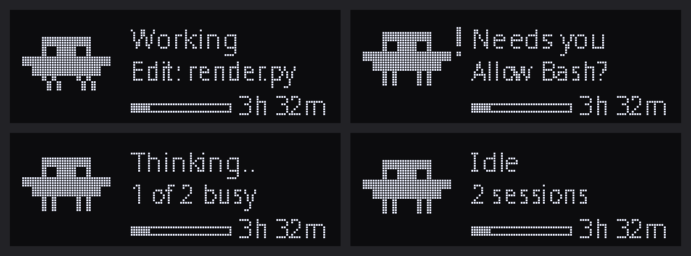

<h1 align="center">Apex Keyboard</h1>

<p align="center">Omarchy shell plugin for SteelSeries Apex keyboards:
per-key RGB, the 128×40 OLED, and the OLED scroll wheel.</p>

<p align="center"></p>

<p align="center"><sub>The OLED's <a href="#claude-code-activity">Claude Code page</a>,
rendered by the plugin's own OLED code at 4× scale (not a photo of the
keyboard). Regenerate with <code>python3 scripts/claude_preview.py</code>.</sub></p>

## Supported keyboards

| Keyboard | USB ID | OLED | RGB | Wheel |
|---|---|---|---|---|
| Apex 7 TKL | `1038:1618` | yes | via OpenRGB | yes |
| Apex 7 | `1038:1612` | yes | via OpenRGB | yes |
| Apex Pro TKL Gen 3 | `1038:1642` | yes | direct HID (no OpenRGB) | yes |

The connected keyboard is detected automatically. On the Apex Pro TKL Gen 3
the `reactive` lighting mode is hidden, because it needs read access to the
keystroke interfaces, which the Gen 3 udev rule deliberately withholds.

## Install

```bash
omarchy plugin add https://github.com/davidzu/sonic.apex.git --enable
```

That clones the plugin, validates it, and enables the bar widget. Nothing
else is installed until you open the widget and click **Set up background
service**, which:

- puts `apexctl` on `PATH` (`~/.local/bin`)
- enables the `apexctl` user systemd service
- installs theme-set and post-boot hooks so lighting follows `omarchy theme set`

### Requirements

- Omarchy (Hyprland + Quickshell)
- Python 3 with Pillow (`omarchy pkg add python-pillow` if it is missing)
- Apex 7 / Apex 7 TKL only: [OpenRGB](https://openrgb.org/) for RGB
  (`omarchy pkg add openrgb`), with its SDK server on `127.0.0.1:6742`

Start OpenRGB once (Apex 7 / Apex 7 TKL):

```bash
systemctl --user enable --now openrgb.service
```

If that unit does not exist yet:

```bash
mkdir -p ~/.config/systemd/user
cat > ~/.config/systemd/user/openrgb.service <<'EOF'
[Unit]
Description=OpenRGB SDK server
After=graphical-session.target

[Service]
ExecStart=/usr/bin/openrgb --server --server-port 6742
Restart=on-failure

[Install]
WantedBy=graphical-session.target
EOF
systemctl --user enable --now openrgb.service
```

### HID permissions

The OLED (and Gen 3 RGB) talk to USB HID interface 1. Install the udev rule
for your keyboard if `apexctl status` shows the OLED as missing:

```bash
# Apex 7 / Apex 7 TKL
sudo cp ~/.config/omarchy/plugins/io.github.davidzu.sonic_apex/udev/99-steelseries-apex.rules /etc/udev/rules.d/
# Apex Pro TKL Gen 3 (control interface and wheel only, not keystrokes)
sudo cp ~/.config/omarchy/plugins/io.github.davidzu.sonic_apex/udev/70-steelseries-apex-pro-tkl-gen3.rules /etc/udev/rules.d/

sudo udevadm control --reload && sudo udevadm trigger
```

Unplug/replug the keyboard if it still cannot open the device.

## Use it

Click the **Apex Keyboard** widget in the bar (right section) to open the
panel: RGB effects, OLED pages (clock, media, workspace, logo, Claude), and
wheel modes.

CLI examples:

```bash
apexctl status
apexctl rgb wave --speed 60
apexctl oled clock
apexctl oled claude
apexctl wheel workspace
```

## Workspace keys

The number row shows your Hyprland workspaces: keys **1**–**9** are
workspaces 1–9 and **0** is workspace 10. Every key stays lit; the colour
says what the workspace is doing:

| Colour | Workspace |
|---|---|
| white | active, on the focused monitor |
| magenta | shown on another monitor |
| green | has windows, but is not on screen |
| deep blue | empty |

It updates instantly from Hyprland's event socket and sits on top of any
lighting mode. A calm background makes it easiest to read, for example
`apexctl rgb solid -c '#106050'` (dim teal).

Change the colours with `"workspace_colors"` under `"rgb"` in
`~/.config/omarchy/apex.json`, using `#RRGGBB` or any colour name from your
Omarchy theme's `colors.toml` (such as `"accent"` or `"green"`). Saturated
colours read best: LEDs wash pastels toward white. Turn the feature off with
`"workspace_keys": false`.

## Claude Code activity

The **claude** OLED page shows what [Claude Code](https://claude.com/claude-code)
is doing, with a small pixel mascot (pictured at the top of this README):

| State | Mascot | Text |
|---|---|---|
| Waiting for your permission | jumps, with a `!` | `Needs you` · `Allow Bash?` |
| Running a tool | walks | `Working` · `Edit: render.py` |
| Between tool calls | bobs | `Thinking…` |
| Reply finished (about 20 s) | blinks | `Done` |
| Nothing happening | blinks | `Idle` · session count |

With several sessions open, the most urgent one is shown. A thin bar along
the bottom shows how much of your 5-hour Claude limit is used, read from the
Omarchy **Agents** widget's data; it is hidden when that data is missing.

While any session is waiting for your permission, the **Esc** key also
flashes orange (about once a second) on top of your normal lighting, so you
notice even when the OLED shows another page. Turn it off with
`"claude_esc": false` under `"rgb"` in `~/.config/omarchy/apex.json`, or
change its colour with `"claude_esc_color"` (default `#FF3C00`).

By default the OLED switches to this page by itself while any session is
busy, or while the focused window is running `claude`, and goes back to
your chosen page afterwards. To keep it only as a page you pick, set
`"claude_auto": false` under `"oled"` in `~/.config/omarchy/apex.json`.

### Turn it on

The page is fed by Claude Code hooks. Add these to `~/.claude/settings.json`,
merging with any `hooks` you already have, and replace `YOU` with your
username (the path must be absolute):

```json
{
  "hooks": {
    "SessionStart":       [{ "hooks": [{ "type": "command", "command": "/home/YOU/.local/bin/apexctl", "args": ["claude-hook"], "async": true, "timeout": 5 }] }],
    "UserPromptSubmit":   [{ "hooks": [{ "type": "command", "command": "/home/YOU/.local/bin/apexctl", "args": ["claude-hook"], "async": true, "timeout": 5 }] }],
    "PreToolUse":         [{ "hooks": [{ "type": "command", "command": "/home/YOU/.local/bin/apexctl", "args": ["claude-hook"], "async": true, "timeout": 5 }] }],
    "PostToolUse":        [{ "hooks": [{ "type": "command", "command": "/home/YOU/.local/bin/apexctl", "args": ["claude-hook"], "async": true, "timeout": 5 }] }],
    "PostToolUseFailure": [{ "hooks": [{ "type": "command", "command": "/home/YOU/.local/bin/apexctl", "args": ["claude-hook"], "async": true, "timeout": 5 }] }],
    "PermissionRequest":  [{ "hooks": [{ "type": "command", "command": "/home/YOU/.local/bin/apexctl", "args": ["claude-hook"], "async": true, "timeout": 5 }] }],
    "PermissionDenied":   [{ "hooks": [{ "type": "command", "command": "/home/YOU/.local/bin/apexctl", "args": ["claude-hook"], "async": true, "timeout": 5 }] }],
    "Notification":       [{ "matcher": "permission_prompt", "hooks": [{ "type": "command", "command": "/home/YOU/.local/bin/apexctl", "args": ["claude-hook"], "async": true, "timeout": 5 }] }],
    "Stop":               [{ "hooks": [{ "type": "command", "command": "/home/YOU/.local/bin/apexctl", "args": ["claude-hook"], "async": true, "timeout": 5 }] }],
    "StopFailure":        [{ "hooks": [{ "type": "command", "command": "/home/YOU/.local/bin/apexctl", "args": ["claude-hook"], "async": true, "timeout": 5 }] }],
    "SessionEnd":         [{ "hooks": [{ "type": "command", "command": "/home/YOU/.local/bin/apexctl", "args": ["claude-hook"], "async": true, "timeout": 5 }] }]
  }
}
```

`apexctl` must already be on your `PATH` (click **Set up background
service** first). The hooks run in the background, so they never slow Claude
Code down, and a failing hook is silently ignored. Review or disable them
with `/hooks` in Claude Code.

**What is recorded:** one small status file per session in
`$XDG_RUNTIME_DIR/apex-claude/` (private to you, cleared on reboot) holding
the state, the tool name, and at most a file's base name. Command text, file
contents and prompts are never stored. Sessions disappear when their `claude`
process exits.

**Known limits:** in terminals that run every window from one process (such
as Ghostty), any window of that terminal counts as "focused" while one of
them runs `claude`. Because the hooks run in the background, a very fast
tool can occasionally show `Working` a moment longer than it ran.

The mascot is an original 1-bit drawing in the spirit of the Claude Code
startup banner.

## Remove

```bash
~/.config/omarchy/plugins/io.github.davidzu.sonic_apex/uninstall
omarchy plugin remove io.github.davidzu.sonic_apex
```

`uninstall` stops the service and removes the `apexctl` link and hooks; your
settings in `~/.config/omarchy/apex.json` are kept. Remove any udev rule you
copied into `/etc/udev/rules.d/` by hand, and delete the `apexctl
claude-hook` entries from `~/.claude/settings.json` if you added them.

## Development

Run the portable checks from the repository root:

```bash
./tests/run
```

On the target Omarchy machine also run `omarchy plugin validate .` and record
the installed `omarchy-version`. Portable validation covers structure and
metadata only; it does not establish live desktop compatibility. Record
actual tests in [docs/ACCEPTANCE.json](docs/ACCEPTANCE.json).

After changing the Claude page's drawing, regenerate its README image with
`python3 scripts/claude_preview.py`.

[Architecture](ARCHITECTURE.md) · [Developing](docs/DEVELOPMENT.md) · [Release process](docs/RELEASE.md) · [Contributing](CONTRIBUTING.md)

## Credits

Apex Keyboard is by [David Zúñiga](https://github.com/davidzu), built from
[omarchy-plugin-template](https://github.com/tcballard/omarchy-plugin-template)
guidance and the Omarchy template set. The Apex Pro TKL Gen 3 OLED and RGB
protocol comes from
[apex-pro-tkl-gen3-linux](https://github.com/SilasDaSilva/apex-pro-tkl-gen3-linux)
by [@SilasDaSilva](https://github.com/SilasDaSilva) (MIT). See [CREDITS.md](CREDITS.md).

## Licence

[MIT](LICENSE).
