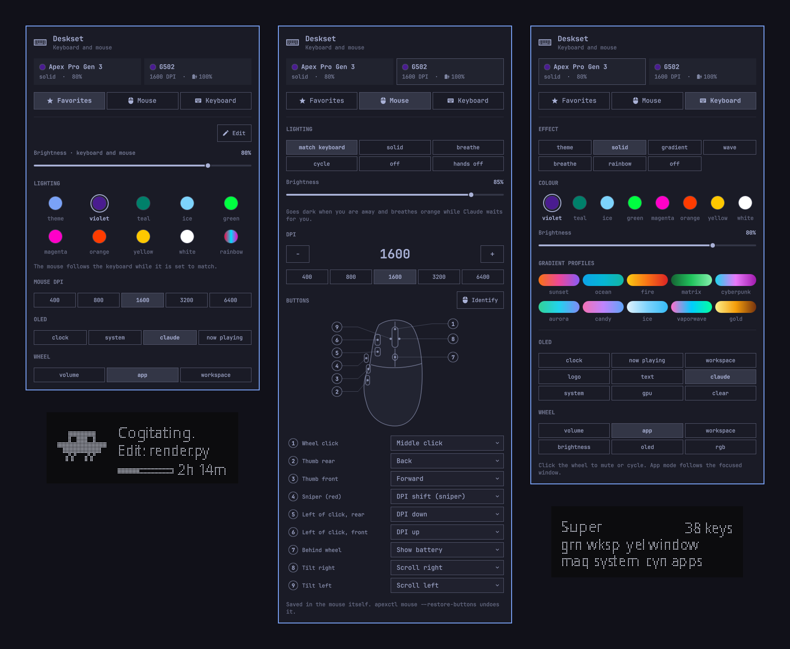
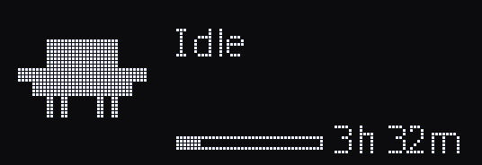

<h1 align="center">Deskset</h1>

<p align="center">Your SteelSeries Apex keyboard and Logitech mouse, run from the
Omarchy bar: per-key lighting, the OLED screen and scroll wheel, mouse lighting,
DPI and buttons, plus your desktop and Claude Code at a glance on the keyboard.</p>

<p align="center"></p>

## What it does

- **Lighting:** theme-matched, solid, gradient, wave, breathe and rainbow
  effects, with the mouse following the keyboard. See [Use it](#use-it).
- **OLED pages:** clock, now playing, workspace, a [CPU/GPU monitor](#system-monitor),
  [Claude Code activity](#claude-code-activity), your own text or image.
- **Scroll wheel:** volume, workspaces or OLED pages, or [app-aware](#app-aware-wheel):
  browser tabs or volume, terminal font size, per-app volume.
- **[Workspace keys](#workspace-keys):** the number row shows your Hyprland
  workspaces by colour.
- **Shortcuts on the keys:** [hold Super](#hold-super-to-see-your-shortcuts)
  to light every key that has a shortcut, or open the
  [cheat sheet](#keybinding-cheat-sheet) and browse them with the wheel.
- **Claude Code:** what it is doing and your 5-hour usage on the OLED, and
  **Esc** flashes when it needs your permission.
- **[Lights out when away](#lights-out-when-away):** dark while the screensaver
  or a blanked lock screen is up.
- **Mouse:** [lighting](#mouse-lighting), [DPI](#dpi) and
  [button remapping](#buttons) stored in the mouse itself, including desktop
  actions.

## Supported hardware

| Device | USB ID | Support |
|---|---|---|
| SteelSeries Apex Pro TKL Gen 3 | `1038:1642` | OLED, per-key RGB (direct HID), wheel |
| SteelSeries Apex 7 TKL | `1038:1618` | OLED, RGB via OpenRGB, wheel |
| SteelSeries Apex 7 | `1038:1612` | OLED, RGB via OpenRGB, wheel |
| Logitech G502 Lightspeed | `046d:c539` receiver, `046d:c08d` wired | lighting, DPI, buttons |

The connected keyboard is detected automatically. Tested on hardware: the Apex
Pro TKL Gen 3 and G502 Lightspeed. Apex 7 / Apex 7 TKL support comes from
the original project and has not been re-tested here. Other Logitech HID++
mice with lighting (feature 0x8070) may work, but need their own udev rule.

On the Apex Pro TKL Gen 3 the `reactive` lighting mode is hidden, because it
needs read access to the keystroke interfaces, which the Gen 3 udev rule
deliberately withholds.

## Install

```bash
omarchy plugin add https://github.com/micahelj/deskset.git --enable
```

That clones the plugin, validates it, and enables the bar widget. Nothing
else is installed until you open the widget and click **Set up background
service**, which:

- puts `apexctl` on `PATH` (`~/.local/bin`)
- enables the `apexctl` user systemd service
- installs theme-set and post-boot hooks so lighting follows `omarchy theme set`

### Requirements

- Omarchy (Hyprland + Quickshell)
- Python 3 with Pillow (`omarchy pkg add python-pillow` if it is missing)
- Apex 7 / Apex 7 TKL only: [OpenRGB](https://openrgb.org/) for RGB
  (`omarchy pkg add openrgb`), with its SDK server on `127.0.0.1:6742`

Start OpenRGB once (Apex 7 / Apex 7 TKL):

```bash
systemctl --user enable --now openrgb.service
```

If that unit does not exist yet:

```bash
mkdir -p ~/.config/systemd/user
cat > ~/.config/systemd/user/openrgb.service <<'EOF'
[Unit]
Description=OpenRGB SDK server
After=graphical-session.target

[Service]
ExecStart=/usr/bin/openrgb --server --server-port 6742
Restart=on-failure

[Install]
WantedBy=graphical-session.target
EOF
systemctl --user enable --now openrgb.service
```

### HID permissions

The OLED (and Gen 3 RGB) talk to USB HID interface 1. Install the udev rule
for your keyboard if `apexctl status` shows the OLED as missing:

```bash
# Apex 7 / Apex 7 TKL
sudo cp ~/.config/omarchy/plugins/io.github.micahelj.deskset/udev/99-steelseries-apex.rules /etc/udev/rules.d/
# Apex Pro TKL Gen 3 (control interface and wheel only, not keystrokes)
sudo cp ~/.config/omarchy/plugins/io.github.micahelj.deskset/udev/70-steelseries-apex-pro-tkl-gen3.rules /etc/udev/rules.d/

sudo udevadm control --reload && sudo udevadm trigger
```

Unplug/replug the keyboard if it still cannot open the device.

For [mouse lighting](#mouse-lighting) on a Logitech G502 Lightspeed (wireless
or wired), also install its rule:

```bash
sudo cp ~/.config/omarchy/plugins/io.github.micahelj.deskset/udev/70-logitech-g502-lightspeed.rules /etc/udev/rules.d/
sudo udevadm control --reload && sudo udevadm trigger
```

## Use it

Click the **Deskset** widget in the bar (right section) to open the
panel. Three tabs pick what it shows:

- **Favorites**: brightness for keyboard and mouse together, lighting presets
  the mouse follows, mouse DPI presets, the everyday OLED pages and wheel modes.
  **Edit** picks which sections show and what each offers (custom colours and
  DPI values too), or from a terminal:
  `apexctl favorites --oled clock,system --dpi 800,1600 --colors theme,#4A1C90`
  (`--reset` for the defaults).
- **Mouse**: lighting, brightness, DPI and button mapping (when a supported
  Logitech mouse is connected).
- **Keyboard**: RGB effects and gradient profiles, every OLED page (clock,
  media, workspace, logo, Claude, system, GPU) and wheel mode.

CLI examples:

```bash
apexctl status
apexctl rgb wave --speed 60
apexctl oled clock
apexctl oled claude
apexctl wheel workspace
```

## Workspace keys

The number row shows your Hyprland workspaces: keys **1**–**9** are
workspaces 1–9 and **0** is workspace 10. Every key stays lit; the colour
says what the workspace is doing:

| Colour | Workspace |
|---|---|
| white | active, on the focused monitor |
| magenta | shown on another monitor |
| green | has windows, but is not on screen |
| deep blue | empty |

It updates instantly from Hyprland's event socket and sits on top of any
lighting mode. A calm background makes it easiest to read, for example
`apexctl rgb solid -c '#106050'` (dim teal).

Change the colours with `"workspace_colors"` under `"rgb"` in
`~/.config/omarchy/apex.json`, using `#RRGGBB` or any colour name from your
Omarchy theme's `colors.toml` (such as `"accent"` or `"green"`). Saturated
colours read best: LEDs wash pastels toward white. Turn the feature off with
`"workspace_keys": false`.

## Lights out when away

The keyboard lighting and the OLED go dark while the Omarchy idle
screensaver is up or the lock screen has turned the displays off, and come
back as soon as you return: waking the lock screen lights the keyboard so you
can see it while typing your password. The screensaver is noticed instantly
from Hyprland's window events; the lock is checked every 2 seconds, and while
locked the displays' power state is checked every 0.4 seconds. Typing still works while dark. Turn it
off with `"away_dark": false` under `"rgb"` in `~/.config/omarchy/apex.json`.

## Mouse lighting

A Logitech mouse with HID++ lighting (feature 0x8070, e.g. the G502
Lightspeed, through its receiver or on a cable) lights up with the keyboard.
Pick a mode in the panel's **Mouse** section or with `apexctl mouse`:

| Mode | Mouse shows |
| --- | --- |
| `match` (default) | The keyboard's look: its solid colour, theme accent or first gradient colour at the keyboard's brightness; breathes with `breathe`; cycles hues with `wave` / `rainbow`; off with `off` |
| `solid` / `breathe` | `mouse.color` (a theme colour name or `#RRGGBB`), steady or breathing |
| `cycle` | Hues rotating on the mouse |
| `off` | Dark |
| `device` | Hands off: the mouse's own onboard lighting |

It goes dark with the keyboard when you are away, and breathes the Claude
alert colour while a Claude Code session waits for you (`mouse.claude`).
Effects run on the mouse itself and are written only when they change, so the
wireless link and battery are spared; writes go to RAM, so the mouse's own
lighting returns after it powers off without the daemon.

```bash
apexctl mouse                  # same as the keyboard
apexctl mouse solid -c "#00FF40" -b 70
apexctl mouse breathe -c magenta
apexctl mouse --no-claude
apexctl mouse --info           # detected mouse, lighting zones and effect IDs
```

### DPI

`apexctl mouse --dpi 1600` sets the sensor (G502: 100–25,600 in steps of 50).
It is re-applied when the mouse reconnects, and a change made with the mouse's
own DPI buttons is picked up, so that DPI comes back after a power cycle.

### Buttons

The extra buttons are remapped in the mouse's active onboard profile, so the
mapping stays in the mouse and works without the daemon, on any computer.
Left and right click are never touched. The first change backs the original
profile up to `~/.config/omarchy/apex-mouse-profile.bak`;
`apexctl mouse --restore-buttons` writes it back.

```bash
apexctl mouse --buttons                    # current mapping and every action
apexctl mouse --button g9=menu --button g7=workspace-next
apexctl mouse --restore-buttons
apexctl mouse --identify                   # press a button to see which one it is
```

Buttons, named by where they sit: `wheel`, `thumb-rear` (back), `thumb-front`
(forward), `sniper`, `left-front` / `left-rear` (the two beside the left click:
DPI up / down), `behind-wheel`, `tilt-left`, `tilt-right` (`g4`-`g9` still
work). The panel draws the mouse with a numbered marker per button; hover a
row to find it, or press **Identify** and then the button, which briefly turns
on the mouse's button spy (HID++ 0x8110) to see which one you pressed. Actions run on the mouse
(back, forward, middle, DPI up / down / shift, scroll left / right, battery,
media keys, copy / paste / undo, nothing) or on the desktop (previous / next
workspace, screenshot, mute microphone, keyboard cheat sheet, Omarchy menu).
Desktop actions send F13–F18, which a marked `[apex-mouse]` block in
`~/.config/hypr/bindings.lua` binds; it is added the first time one is
chosen (with a `.bak.apex-mouse` copy of the file) and removed by `uninstall`.

## System monitor

The **system** OLED page shows three rows, each with a value and about a
minute of history as a small graph, and switches between two views every
6 seconds:

- **CPU:** CPU load, memory in use (reclaimable cache counts as free) and
  CPU temperature (Intel `coretemp`, AMD `k10temp`, or the ACPI sensor).
- **GPU:** NVIDIA GPU load, video memory and temperature, via `nvidia-smi`.

Pick **gpu** instead to keep the GPU view on screen. The GPU is only polled
while a GPU view is showing, and a suspended GPU is never woken: the system
page skips it and the gpu page says `GPU asleep`. While the GPU is being
polled it cannot runtime-suspend, so on a laptop running on battery choose
another page when you do not need it. Other GPU vendors are not supported
yet; the system page then shows only the CPU view.

## App-aware wheel

Set the wheel to **app** (`apexctl wheel app`, or in the panel) and what it
does follows the focused window:

| Focused window | Scroll | Click |
|---|---|---|
| Claude Code | system volume (never answers a prompt) | mute |
| Browser playing audio or video | the browser's own volume | mute the browser |
| Browser, nothing playing | previous / next tab | reopen the last closed tab |
| Terminal (Ghostty, Alacritty, foot, kitty) | font size | reset font size |
| Any other app playing sound | that app's own volume | mute just that app |
| Anything else | system volume | mute |

The OLED briefly shows what the wheel does when focus changes it
(`Wheel · Tabs`) and the result of each turn (`Next tab →`,
`Chromium 70%`). Per-app volume also shows Omarchy's on-screen volume bar,
labelled with the app's name. A paused player stops counting as playing,
so a browser goes back to tab switching as soon as the video is paused.

## Keybinding cheat sheet

`apexctl cheatsheet` lights every key bound under one modifier set, so you
can see your Hyprland shortcuts on the keyboard itself:

| Colour | Bindings |
|---|---|
| green | workspaces |
| yellow | windows (focus, resize, float, close, …) |
| magenta | system (menus, clipboard, notifications, …) |
| cyan | apps |
| white | the modifier keys of the current set |

Unbound keys go dark. Scroll the wheel to step through the bindings in
keyboard order: the selected key pulses and the OLED shows the key and what
it does. Click the wheel for the next modifier set (Super, Super + Ctrl,
Super + Shift, …). Run the command again, or leave it alone for 30 seconds,
to close it; the wheel then goes back to its normal mode.

Bind it to a shortcut in `~/.config/hypr/bindings.lua` (use your own path):

```lua
-- [apex-cheatsheet]
o.bind("SUPER + CTRL + SLASH", "Keyboard cheat sheet", "/home/YOU/.local/bin/apexctl cheatsheet")
-- [/apex-cheatsheet]
```

Keep the `-- [apex-cheatsheet]` marker lines: `uninstall` uses them to remove
the binding again.

Bindings come from `omarchy menu keybindings --print`, so the cheat sheet
always reflects your current config. Mouse and media-key bindings have no
key to light and are skipped, as are keys your keyboard lacks (the Apex Pro
TKL Gen 3 has no Print Screen, Scroll Lock or Pause).

### Hold Super to see your shortcuts

Hold **Super** for a moment and the keyboard shows the keys bound under the
modifiers you're holding, in the cheat sheet's colours. Add Shift, Ctrl or
Alt to see that layer instead. The OLED names the layer and lists the colours.
Let go and your lighting comes back. A quick Super shortcut finishes before
the overlay appears (`rgb.super_peek_delay`, 0.25 s by default); turn it off
with `"super_peek": false` under `rgb` in `~/.config/omarchy/apex.json`.

The daemon can't read your keystrokes (the keyboard's typing interfaces stay
root-only), so Hyprland tells it when a modifier goes down or up. Add this to
`~/.config/hypr/bindings.lua` (use your own path to `apexctl`):

```lua
-- [apex-super]
do
  local apexctl = "/home/YOU/.local/bin/apexctl"
  local mods = { [133] = "super", [134] = "super", [50] = "shift", [62] = "shift",
                 [37] = "ctrl", [105] = "ctrl", [64] = "alt", [108] = "alt" }
  local down = {}
  hl.on("input.keyboard.key", function(keycode, _time, pressed)
    local mod = mods[keycode]
    local is_down = pressed == 1
    if mod and down[keycode] ~= is_down then
      down[keycode] = is_down
      hl.exec_cmd(apexctl .. " modkey " .. mod .. (is_down and " down" or " up"))
    end
  end)
end
-- [/apex-super]
```

Keep the `-- [apex-super]` marker lines: `uninstall` uses them to remove
the block again. It uses key events rather than release binds because Hyprland skips a
release bind when another key was pressed in between, which would leave the
overlay up after every Super shortcut.

## Claude Code activity

The **claude** OLED page shows what [Claude Code](https://claude.com/claude-code)
is doing, with a small pixel mascot:

| State | Mascot | Text |
|---|---|---|
| Waiting for your permission | jumps, with a `!` | `Needs you` · `Allow Bash?` |
| Running a tool | walks | `Cogitating…` · `Edit: render.py` |
| Between tool calls | bobs | `Cogitating…` |
| Reply finished (about 20 s) | blinks | `Done` |
| Nothing happening | blinks | `Idle` · session count |

<p align="center"></p>

<p align="center"><sub>Rendered by the plugin's own OLED code at 4× scale (not a
photo of the keyboard). Regenerate with <code>python3 scripts/claude_preview.py</code>.</sub></p>

While Claude is working, the first line shows a word picked fresh for each
prompt (`Cogitating…`, `Noodling…`, `Percolating…`), much like Claude Code's
own spinner, and it stays put until the turn ends. A session moved to Claude
Code's background daemon is forked under a new id while the original process
stays alive; the plugin counts that as one session, not two. Idle sessions
parked in that daemon are not open anywhere, so they are not counted until
they start working again.

Choosing another OLED page (panel, `apexctl oled`, or the wheel) flashes its
name for about a second and then shows it for a few seconds even while a
Claude session would otherwise keep the Claude page up, so the change is
visible.

With several sessions open, the most urgent one is shown. A thin bar along
the bottom shows how much of your 5-hour Claude limit is used, with a
countdown beside it until that window refreshes (`3h 05m`, `42m`, `<1m`),
read from the Omarchy **Agents** widget's data; the bar is hidden when that
data is missing, and the countdown once the window has already refreshed.

While any session is waiting for your permission, the **Esc** key also
flashes orange (about once a second) on top of your normal lighting, so you
notice even when the OLED shows another page. Turn it off with
`"claude_esc": false` under `"rgb"` in `~/.config/omarchy/apex.json`, or
change its colour with `"claude_esc_color"` (default `#FF3C00`).

By default the OLED switches to this page by itself while any session is
busy, or while the focused window is running `claude`, and goes back to
your chosen page afterwards. To keep it only as a page you pick, set
`"claude_auto": false` under `"oled"` in `~/.config/omarchy/apex.json`.

### Turn it on

The page is fed by Claude Code hooks. Add these to `~/.claude/settings.json`,
merging with any `hooks` you already have, and replace `YOU` with your
username (the path must be absolute):

```json
{
  "hooks": {
    "SessionStart":       [{ "hooks": [{ "type": "command", "command": "/home/YOU/.local/bin/apexctl", "args": ["claude-hook"], "async": true, "timeout": 5 }] }],
    "UserPromptSubmit":   [{ "hooks": [{ "type": "command", "command": "/home/YOU/.local/bin/apexctl", "args": ["claude-hook"], "async": true, "timeout": 5 }] }],
    "PreToolUse":         [{ "hooks": [{ "type": "command", "command": "/home/YOU/.local/bin/apexctl", "args": ["claude-hook"], "async": true, "timeout": 5 }] }],
    "PostToolUse":        [{ "hooks": [{ "type": "command", "command": "/home/YOU/.local/bin/apexctl", "args": ["claude-hook"], "async": true, "timeout": 5 }] }],
    "PostToolUseFailure": [{ "hooks": [{ "type": "command", "command": "/home/YOU/.local/bin/apexctl", "args": ["claude-hook"], "async": true, "timeout": 5 }] }],
    "PermissionRequest":  [{ "hooks": [{ "type": "command", "command": "/home/YOU/.local/bin/apexctl", "args": ["claude-hook"], "async": true, "timeout": 5 }] }],
    "PermissionDenied":   [{ "hooks": [{ "type": "command", "command": "/home/YOU/.local/bin/apexctl", "args": ["claude-hook"], "async": true, "timeout": 5 }] }],
    "Notification":       [{ "matcher": "permission_prompt", "hooks": [{ "type": "command", "command": "/home/YOU/.local/bin/apexctl", "args": ["claude-hook"], "async": true, "timeout": 5 }] }],
    "Stop":               [{ "hooks": [{ "type": "command", "command": "/home/YOU/.local/bin/apexctl", "args": ["claude-hook"], "async": true, "timeout": 5 }] }],
    "StopFailure":        [{ "hooks": [{ "type": "command", "command": "/home/YOU/.local/bin/apexctl", "args": ["claude-hook"], "async": true, "timeout": 5 }] }],
    "SessionEnd":         [{ "hooks": [{ "type": "command", "command": "/home/YOU/.local/bin/apexctl", "args": ["claude-hook"], "async": true, "timeout": 5 }] }]
  }
}
```

`apexctl` must already be on your `PATH` (click **Set up background
service** first). The hooks run in the background, so they never slow Claude
Code down, and a failing hook is silently ignored. Review or disable them
with `/hooks` in Claude Code.

**What is recorded:** one small status file per session in
`$XDG_RUNTIME_DIR/apex-claude/` (private to you, cleared on reboot) holding
the state, the tool name, and at most a file's base name. Command text, file
contents and prompts are never stored. Sessions disappear when their `claude`
process exits.

**Known limits:** in terminals that run every window from one process (such
as Ghostty), any window of that terminal counts as "focused" while one of
them runs `claude`. Because the hooks run in the background, a very fast
tool can occasionally show `Working` a moment longer than it ran.

The mascot is an original 1-bit drawing in the spirit of the Claude Code
startup banner.

## Remove

```bash
~/.config/omarchy/plugins/io.github.micahelj.deskset/uninstall
omarchy plugin remove io.github.micahelj.deskset
```

`uninstall` stops the service and removes the `apexctl` link and hooks; your
settings in `~/.config/omarchy/apex.json` are kept. Remove any udev rule you
copied into `/etc/udev/rules.d/` by hand, and delete the `apexctl
claude-hook` entries from `~/.claude/settings.json` if you added them.

## Development

Run the portable checks from the repository root:

```bash
./tests/run
```

On the target Omarchy machine also run `omarchy plugin validate .` and record
the installed `omarchy-version`. Portable validation covers structure and
metadata only; it does not establish live desktop compatibility. Record
actual tests in [docs/ACCEPTANCE.json](docs/ACCEPTANCE.json).

After changing the Claude page's drawing, regenerate its README image with
`python3 scripts/claude_preview.py`.

[Architecture](ARCHITECTURE.md) · [Developing](docs/DEVELOPMENT.md) · [Release process](docs/RELEASE.md) · [Contributing](CONTRIBUTING.md)

## Credits

Deskset began as a fork of [Apex Keyboard (sonic.apex)](https://github.com/davidzu/sonic.apex)
by [David Zúñiga](https://github.com/davidzu), which was built from
[omarchy-plugin-template](https://github.com/tcballard/omarchy-plugin-template)
guidance and the Omarchy template set. The Apex Pro TKL Gen 3 OLED and RGB
protocol comes from
[apex-pro-tkl-gen3-linux](https://github.com/SilasDaSilva/apex-pro-tkl-gen3-linux)
by [@SilasDaSilva](https://github.com/SilasDaSilva) (MIT). See [CREDITS.md](CREDITS.md).

## Licence

[MIT](LICENSE).
